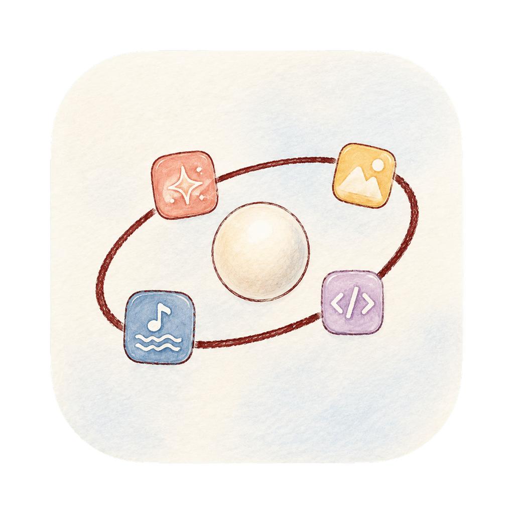
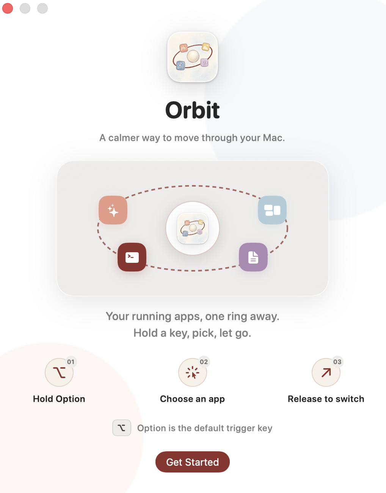

<p align="center">
  
</p>

<h1 align="center">Orbit</h1>

<p align="center">
  <strong>面向 macOS 的原生應用切換器，為想要更快切換視窗的人而做。</strong>
</p>

<p align="center">
  <a href="https://github.com/ycl-2004/Orbit/releases/latest"></a>
  <a href="https://github.com/ycl-2004/Orbit/releases"></a>
  <a href="https://github.com/ycl-2004/Orbit/actions/workflows/ci.yml"></a>
  
  
  <a href="LICENSE"></a>
</p>

<p align="center">
  <a href="https://github.com/ycl-2004/Orbit/releases/latest/download/Orbit-macOS.zip"><strong>⬇ 下載 macOS 版</strong></a>
  ·
  <a href="https://github.com/ycl-2004/Orbit/releases">版本釋出</a>
  ·
  <a href="#功能">功能</a>
  ·
  <a href="#路線圖">路線圖</a>
  ·
  <a href="CONTRIBUTING.md">參與貢獻</a>
  ·
  <a href="README.md">English</a>
</p>

<p align="center">
  
</p>

<p align="center">
  <sub>App Intro / Welcome：按住 Option、選擇應用、鬆手切換。</sub>
</p>

按住一個修飾鍵，正在執行的應用就環繞在滑鼠周圍。朝目標方向一甩、鬆手，切換完成。
不用掃列表，不用連按 Command-Tab，也不用滿屏找視窗。Orbit 是一個用 SwiftUI 和
AppKit 寫的選單欄應用，沒有任何第三方依賴，也不聯網——所有處理都在本機完成。

> **自由的開放原始碼軟體。** Orbit 採用 [GNU 通用公共授權條款第 3 版](LICENSE)：可以在任何
> 地方使用，可以閱讀和修改原始碼，也可以分享你的修改，前提是你分發出去的版本同樣採用這份
> 授權。Orbit 的名稱和 Logo 不在授權範圍內，詳見[授權](#授權)。

## 快速開始

1. **[下載 `Orbit-macOS.zip`](https://github.com/ycl-2004/Orbit/releases/latest/download/Orbit-macOS.zip)** 並解壓。需要 macOS 14.0 或更高版本；正式包是同時支援 Apple Silicon 與 Intel Mac 的 Universal 2 建構。
2. 把 `Orbit.app` 移到 `/Applications` 並開啟。這個建構是 ad-hoc 簽名、未經 Apple 公證的，macOS 會攔下第一次啟動：關掉提示框，打開**系統設定 → 隱私權與安全性**，在 Orbit 那條訊息旁點**強制打開**。
3. 按提示授予**輔助功能（Accessibility）**權限，然後在任意介面長按 **Option（⌥）** 撥出環。

如果沒有出現**強制打開**，改為手動清除隔離標記：

```bash
xattr -dr com.apple.quarantine /Applications/Orbit.app
open /Applications/Orbit.app
```

只有啟用視窗預覽時，Orbit 才會請求螢幕錄製權限。

當前 Xcode 工程版本為 `1.7.0（build 8）`。從 `v1.6.0` 以來的改動見
[1.7.0 釋出說明](CHANGELOG.md)。

## 為什麼用 Orbit

- **固定的第一目標。** 當前應用有可切換的其他視窗時，最近的另一扇視窗入口固定在 12 點鐘方向；否則這裡才是上一個應用。卡片數量或預覽設定變化時，第一個鍵盤目標不會移動。
- **切到具體視窗，而不只是應用。** 開啟預覽後，鬆手前可以用左右方向鍵在選中應用的多個視窗裡挑一個。
- **既跟手又穩定。** Orbit 根據最近啟用歷史決定環裡顯示哪些應用，然後可以在設定中選擇按最近使用或按名稱排列這些卡片。
- **中心就是拖放目標。** 把應用卡片拖進中心即可退出；可選的 Orbit 特殊卡片可以安全清理沒有開啟視窗的普通應用，Orbit 自己和 Finder 始終受到保護。把檔案拖進去可以 AirDrop，長按則移入廢紙簍。
- **資料不出本機。** 無帳號、無埋點、無網路請求。純原生 SwiftUI/AppKit，零第三方包。

## 功能

**切換**

- 長按修飾鍵撥出環形應用切換器，預設觸發鍵為 Option（⌥）。
- 預設使用方向鍵導航；可在設定中按需啟用字母和數字快捷鍵。
- 可選的環旁視窗預覽：在**設定 → 外觀**中開啟“顯示視窗預覽”，並授予螢幕錄製權限；macOS 授權後需要重啟 Orbit。
- 設定裡的**開啟 Orbit 時**可以選擇行為。預設的**從取消開始**不會選中任何目標；**快速切換**會預選 12 點目標，鬆手立即切到當前應用最近的另一扇視窗；沒有其他視窗時才切回上一個應用。
- 可在**設定 → 快捷鍵**中開啟“直接顯示扇形”，讓完整扇形直接出現而不播放展開動畫；預設仍保留動畫。
- 長按尚未完成時，如果先按了其他鍵、滑鼠按鈕或滾輪，Orbit 會取消這次待觸發狀態，避免誤開啟環。

**中心目標操作**

- 將應用拖到中心目標即可退出，並顯示畫素消散動畫。
- 可在設定中顯示 Orbit 特殊卡片；將它拖到中心會禮貌退出符合條件的無視窗應用，Orbit 自身和 Finder 永遠不會被退出。
- 將檔案拖到中心即可 AirDrop；持續停留後可改為移入廢紙簍。

**個性化**

- 支援調整介面語言、最近使用/按名稱排列、從取消開始/快速切換、預覽大小（70%–150%）、觸發鍵、取消選擇鍵、字母/數字快捷鍵、長按閾值、環出現位置、卡片大小/材質和開機啟動。
- 語言選擇器包含 English、簡體中文、繁體中文、日本語、한국어、Deutsch、Français、Русский、Dansk、Norsk bokmål 和 Esperanto。切換語言後會提示重啟，讓整個介面一致地重新載入。
- 預覽會根據 Orbit 被撥出的目標顯示器取圖，多顯示器或不同解析度組合下也能保持清晰和穩定。

## 使用方式

- 長按觸發鍵，在滑鼠附近開啟 Orbit。
- 懸停或點選卡片進行選擇；鬆開觸發鍵或按 Enter 確認。
- 按 Escape 取消。點選中心執行它當前顯示的動作：沒有選中應用時是取消，選中應用後是確認切換。
- 預設使用方向鍵（以及 Tab）導航；環處於未選擇狀態時，任一方向鍵都會先進入 12 點目標：當前應用有其他視窗時是最近的另一扇視窗，否則是上一個應用。繼續按鍵則按最近使用順序前進。可在設定中啟用數字鍵 `1`–`9` 或首字母匹配作為額外快捷鍵。
- 啟用視窗預覽且應用有多個視窗時，使用左/右方向鍵選擇視窗；鬆開觸發鍵或按 Enter 開啟它。
- 按取消選擇鍵（預設 Shift）清除高亮；隨後鬆開觸發鍵會關閉 Orbit 且不切換應用。
- 將應用卡片拖到中心並釋放即可退出應用。
- Orbit 開啟後，把檔案拖到中心目標並立即鬆手會觸發 AirDrop；在中心停留 0.9 秒，目標變成廢紙簍後再鬆手，會把檔案移入 macOS 廢紙簍。檔案處理完成前 Orbit 會保持開啟。
- 點選選單欄圖示可以開啟設定、權限頁面或退出應用。

## 截圖

<details open>
<summary>環形切換、檔案操作、視窗預覽與設定（共 8 張）</summary>

| Orbit 環 | 檔案分享 | 檔案刪除 |
| --- | --- | --- |
|  |  |  |

| 退出應用 | 設定 | 歡迎頁 |
| --- | --- | --- |
|  |  |  |

| 視窗預覽 | 選擇具體視窗 |
| --- | --- |
|  |  |

這些截圖展示了當前 macOS 版本的 Orbit 功能流程。它們已經裁掉 macOS 選單欄和桌面
外框，並統一為 1556×900，方便在文件中保持一致。真實 PNG 儲存在 `photos/` 中，
README 與倉庫內的產品截圖保持同步。

</details>

## 路線圖

以下只是方向，不是承諾；順序和範圍會隨著實際反饋調整。想推動某一項，歡迎開
[issue](https://github.com/ycl-2004/Orbit/issues) 說明理由。

- [ ] 經 Apple 公證的簽名建構，首次啟動不再需要繞過步驟
- [ ] 通過 Homebrew Cask 分發
- [ ] 獨立於最近使用集合的置頂應用
- [ ] 更多環形佈局與外觀選項
- [ ] 翻譯校對與更多語言覆蓋
- [ ] 全流程的鍵盤操作與無障礙支援

## 參與貢獻

歡迎提 issue 和 PR——附上 macOS 版本與 Orbit 版本的 bug 報告是最有價值的貢獻。

- 建構、測試與 PR 規範見 **[CONTRIBUTING.md](CONTRIBUTING.md)**。
- 第一次參與？可以從 **[good first issue](https://github.com/ycl-2004/Orbit/issues?q=is%3Aissue+is%3Aopen+label%3A%22good+first+issue%22)** 開始。
- 較大的改動請先開 issue 討論，先對齊做法再動手。貢獻的程式碼與本專案一樣採用 GPL-3.0 授權。

## 常見問題

<details>
<summary>macOS 提示"無法開啟，因為無法驗證開發者"</summary>

釋出版是 ad-hoc 簽名、未經 Apple 公證的，所以第一次啟動會被 Gatekeeper 攔截。
打開**系統設定 → 隱私權與安全性**，在 Orbit 那條訊息旁點**強制打開**，或執行
`xattr -dr com.apple.quarantine /Applications/Orbit.app`。公證建構已列入
[路線圖](#路線圖)。

</details>

<details>
<summary>為什麼需要輔助功能和螢幕錄製權限？</summary>

**輔助功能**權限是全域修飾鍵觸發所必需的——沒有它，你在 Orbit 自身視窗之外按下
觸發鍵時，macOS 不會通知 Orbit。**螢幕錄製**權限只在你開啟視窗預覽時才請求，
因為即時視窗縮圖屬於螢幕內容；macOS 要求授權後重啟 Orbit 才生效。所有畫面都
不會被儲存或上傳——Orbit 究竟讀取和保留了什麼，詳見[隱私政策](PRIVACY.md)。

螢幕錄製權限同時覆蓋*視窗標題*，所以它換來的不只是縮圖：有這個權限時，Orbit
才能把其他 Space 上的同應用視窗列為目標，也才能在應用的“視窗”選單裡找到對應的
那一項。沒有它時，視窗級切換隻覆蓋當前螢幕上的視窗，瀏覽器的精確視窗切換也會更
頻繁地走到 Apple Events 兜底。應用之間的切換不受影響。

**正常切換不需要自動化權限。** Orbit 通常通過輔助功能（包括目標應用的“視窗”選單）
到達所選視窗。只有這些路徑無法完成精確切換時，Orbit 才會嘗試 Apple Events 兜底；
macOS 會在那一刻詢問，拒絕後 Orbit 只會退回普通的應用切換。

</details>

<details>
<summary>如何切換 Orbit 的介面語言？</summary>

點選選單欄圖示，進入**設定 → 通用 → 語言**，選擇**跟隨系統**或 Orbit 自帶的語言。
選擇變化後 Orbit 會顯示重啟提示；重啟後所有檢視和選單都會使用新的語言。

</details>

<details>
<summary>如何解除安裝 Orbit？</summary>

從選單欄圖示退出 Orbit，然後把 `/Applications/Orbit.app` 移到廢紙簍。如果還想
清除偏好設定：

```bash
defaults delete app.orbit.local
```

權限可以在**系統設定 → 隱私與安全性 → 輔助功能 / 螢幕錄製 / 自動化**中撤銷。

</details>

<details>
<summary>Orbit 會聯網嗎？</summary>

不會。沒有帳號、沒有統計分析、沒有第三方依賴包。AirDrop 傳輸完全交由 macOS 處理，
不經過任何 Orbit 的伺服器。

</details>

## 從原始碼建構

<details>
<summary>環境要求、建構與測試命令</summary>

環境要求：

- macOS 14.0 或更高版本。
- 正式釋出包包含 `arm64` 與 `x86_64` 兩種架構，支援 Apple Silicon 和 Intel Mac。
- Xcode 26 或更高版本。
- Accessibility 權限，用於全域修飾鍵觸發。
- 如果啟用即時視窗預覽，還需要 Screen Recording 權限。

倉庫的 **Code → Download ZIP** 下載的是原始碼樹；"快速開始"中的連結則提供可直接
使用的 `.app`。你也可以使用 Xcode（或下面的命令）自行建構；若要在本機正常簽名
或分發，請選擇自己的 Team，並將本地 Bundle Identifier 改成你帳號下的唯一值。
專案沒有第三方依賴。

使用 Xcode 開啟 `Orbit.xcodeproj`，選擇 **My Mac**，然後點選 **Run**。
共享工程不會儲存開發者 Team ID。如果 Xcode 要求籤名，請選擇你自己的 Team，
並把本地 bundle identifier 改成你帳號下唯一的標識。

無需簽名身份即可驗證建構：

```bash
xcodebuild -project Orbit.xcodeproj -scheme Orbit -configuration Debug \
  -destination 'platform=macOS' -derivedDataPath .build/xcode \
  CODE_SIGNING_ALLOWED=NO build
```

執行包含單元測試和 UI 測試的完整測試套件：

```bash
xcodebuild -project Orbit.xcodeproj -scheme Orbit -configuration Debug \
  -destination 'platform=macOS' -derivedDataPath .build/xcode clean test \
  CODE_SIGNING_ALLOWED=NO CODE_SIGNING_REQUIRED=NO
```

只跑單元測試的快速迴圈：

```bash
xcodebuild -project Orbit.xcodeproj -scheme Orbit -configuration Debug \
  -destination 'platform=macOS' -derivedDataPath .build/xcode \
  CODE_SIGNING_ALLOWED=NO CODE_SIGNING_REQUIRED=NO test -only-testing:OrbitTests
```

倉庫會排除建構產物、DerivedData、Xcode 使用者狀態、本地環境檔案、金鑰、日誌和本地工作流狀態。
原始碼、資源、測試、工程檔案、workspace 資料和公開文件都會保留在 Git 中。

Universal 2 檢查、乾淨機器安裝和權限迴歸清單見
[docs/release-checklist.md](docs/release-checklist.md)。GitHub Actions 會在每次 push
和 pull request 上執行後設資料檢查、Debug Universal 2 建構以及 `OrbitTests` 單元測試。

</details>

## 專案結構

- `Orbit/` — 應用原始碼、配置、資源和 asset catalog。
- `Orbit/Ring/` — 圓環本身：它的 view model 與版面，以及每個視圖各一個檔案（卡片、中心、預覽面板、背景光、軌道、遮罩）。
- `Orbit/Services/` — 視窗伺服器、輔助使用與 Apple 事件的存取、事件監聽、視窗預覽，以及決定環上順序的記憶體內啟用歷史。
- `Orbit/Config/` 與 `Orbit/Settings/` — 儲存的設定、固定的幾何與時間常數（`OrbitTuning.swift`）、語言，以及設定視窗。
- `OrbitTests/` — 互動與選擇邏輯的單元測試。
- `OrbitUITests/` — UI 測試目標。
- `Orbit.xcodeproj/` — 共享 Xcode 工程和 workspace 資料。
- `photos/` — README 截圖、App Intro 介紹圖和輔助圖片。
- `artwork/` — 專案海報。
- `scripts/` — 安裝、釋出打包與演示動圖生成指令碼。
- `docs/decisions/` — 產品與工程決策記錄。

## 關於 Orbit

Orbit 是一個獨立的原生 macOS 專案，圍繞環形、手勢優先的工作流打造。
本倉庫包含：

- 完整的 SwiftUI/AppKit 原始碼、資源、測試和共享 Xcode 工程。
- 使用 `app.orbit.local` 作為可替換的 bundle identifier。
- 不包含開發者 Team ID、簽名證書或機器專屬的 Xcode 狀態檔案。
- 預設提供英文 README，並單獨提供這份繁體中文 README。
- 當前原始碼版本：`1.7.0（build 8）`。
- App 預設使用英文介面；應用內語言選擇器提供 English、簡體中文、繁體中文、日本語、한국어、Deutsch、Français、Русский、Dansk、Norsk bokmål 和 Esperanto。

## 致謝

Orbit 的核心構想 —— 按住修飾鍵，正在執行的應用便圍著遊標排成一圈 —— 受
[yuzeguitarist/Orbit](https://github.com/yuzeguitarist/Orbit)（作者 Yuze Pan，潘禹澤）啟發。

動手寫程式之前（2026 年 8 月），我詢問了原作者能否修改其專案，或參考其理念開發
類似作品。對方表示原始碼並未完全開源，因此不能修改原專案，但很歡迎我開發一個
類似的作品。本倉庫就是這個作品：從零寫成，共享的是理念，沒有使用任何原始碼。
本專案與原專案沒有從屬關係，也未獲其背書。感謝 Yuze Pan 的創意與慷慨答覆。

## 授權

Copyright (C) 2026 ycl-2004

Orbit 是自由軟體：你可以依照自由軟體基金會發布的 GNU 通用公共授權條款第 3 版，
再分發和修改它。發布 Orbit 是希望它有用，但不提供任何擔保，也不擔保適銷性或
特定用途的適用性。完整條款見 [LICENSE](LICENSE)。

簡單來說：

- 個人或工作中都可以免費使用 Orbit。
- 可以閱讀、修改和自行建構原始碼。
- 分發 Orbit 或其修改版時，必須同樣以 GPL-3.0 提供原始碼。

**名稱與 Logo。** 授權涵蓋的是程式碼，不包括 Orbit 的名稱和 Logo。你分發的修改版
應使用自己的名稱和圖示，讓人能和官方版本區分開。

## 連結

- [下載最新版本](https://github.com/ycl-2004/Orbit/releases/latest)
- [Issues](https://github.com/ycl-2004/Orbit/issues)
- [貢獻指南](CONTRIBUTING.md)
- [隱私政策](PRIVACY.md)
- [決策記錄](docs/decisions)
- [English README](README.md)
